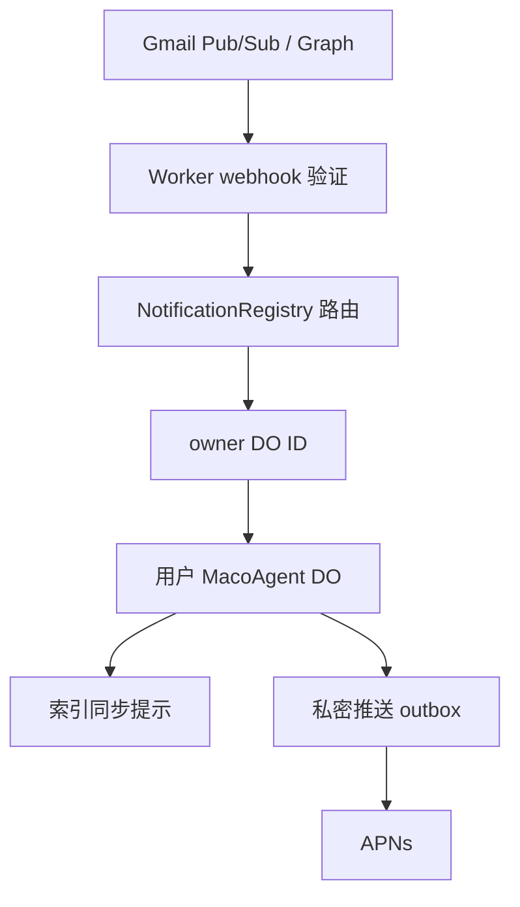

# v0.4 架构与运行边界

**本文描述 v0.4 已实现的独立后端，不表示已完成生产部署或旧 App 切流。** 当前路径是先部署新的 `maco-harness`，再改造 App；使用新 `MacoAgent`、`NotificationRegistry` namespace 和私有 R2，不自动导入旧聊天、凭据、待发操作或附件。原址接替 `maco-agent-cloud / AgentAccount` 属于另行验收的迁移方案，不能通过修改 Worker 名称直接实现。

客户端直接连接 Cloudflare Worker；用户 DO 调用模型、Gmail 或 Microsoft Graph，再把持久事件和结果同步给客户端。Supabase 负责登录身份，Worker 校验 JWT；邮件、模型、文件和记忆不经 Supabase 中转。常规邮件任务无需沙盒、常驻容器、独立 Agent 服务器、消息队列或向量数据库。附件解析与托管复杂子任务是按需分支。

实际接口、默认值和部署条件以 [README](../README.md)、[客户端协议](protocol.md)和 [Cloudflare 部署](cloudflare-deploy.md)为准。

## 1. 分层与依赖方向

| 层 | 模块 | 职责 |
| --- | --- | --- |
| 入口与身份 | `worker.mjs`、`auth.mjs`、`http.mjs`、`sessions.mjs` | JWT、Origin、大小限制、请求会话、WebSocket 与独立 webhook 入口 |
| 应用与事务 | `service.mjs`、`store.mjs` | 组合领域服务，持久命令、版本、事件与幂等回执 |
| 任务执行 | `harness.mjs`、`task-scope.mjs`、`runtime-tools.mjs` | 独立 Task/run、资源范围、模型循环、动态工具与等待状态 |
| 唯一调度器 | `scheduler.mjs`、`schedules.mjs` | 每用户一个 alarm、即时推进、有限并发、持久只读周期任务 |
| 模型与邮箱 | `model/`、`mail/`、`mail-executor.mjs`、`mail-ui.mjs` | 供应商协议、有界读取、冻结审批与唯一邮箱写入账本 |
| 凭据与连接器 | `connections/`、`connectors/` | 加密凭据、OAuth/刷新、连接 epoch、MCP 权限与独立操作账本 |
| 文件与子任务 | `assets/`、`executors/` | 私有 R2、解析缓存、复杂任务委派、产物回收与清理 |
| 索引与记忆 | `mail-index/`、`history/`、`memory/` | 邮件片段索引、跨任务历史、事实与偏好；资料不能扩大权限 |
| 交互与设备结果 | `interactions.mjs`、`client-state.mjs`、`usage.mjs` | 跨设备问题/答案、待办、端侧摘要分类同步与用量 |
| 生命周期与通知 | `account/`、`notifications/` | 分阶段账户清理、私密推送 outbox、订阅续期与独立路由 registry |

`model/compaction.mjs` 管理持久摘要检查点，`model/context.mjs` 负责有界上下文投影。业务模块只提交状态、事件和下一次到期时间，不各自建立常驻循环。增加模型主要修改适配层；增加工具需要同时定义范围、授权、恢复语义及有意义的验证。

增加模型协议主要修改模型适配层；增加邮箱动作必须同时定义能力、OAuth scope、产品授权、请求冻结和测试。
不要让模型拼任意 HTTP 请求，也不要让客户端绕过命令账本直接执行本仓库管理的邮箱修改。

## 2. 用户 DO、Task 与模型上下文

**一个用户 DO 是数据与协调边界，一个 Task 是执行边界，一次模型请求是上下文边界。**
DO 保存该用户的连接、任务、事件、操作、索引和记忆；它不等于每用户常驻服务器或虚拟机。
多个 Task 可以并行，拥有各自的 runId、预算、消息和等待状态；同一 Task 可通过 steering 继续或调整目标。
恢复、重试和换设备不需要依赖模型供应商保存的长会话。

**个人聊天时间线已有服务端聚合。** 同一个 `conversationId`（默认 `primary`）可以包含多个 Task，服务端提供会话列表与分页消息；App 使用同一事件流同步，不需要把多个任务拼成一个无限增长的模型 session。Task 可以绑定多个邮箱、MCP 连接和资产，也可以不绑定邮箱。每个工具仍受该 Task 的实际资源范围约束。
云端只把当前 Task 的有界历史、合法工具配对、最初目标、最新用户调整和相关记忆投影给模型。
上下文准备有界读取原始消息元数据，保留最初目标、最新用户调整和近期配对完整的工具交换；压力过高时先裁剪工具文本，再按需摘要较旧的记录。摘要存入独立 checkpoint 表，原始消息不变；超出每次处理预算的区间通过 coverage 和提示披露。输入预算采用保守 UTF-8 字节估算，不声称等于供应商实际 token 数。
长期连续使用靠持久历史与按需检索，不靠把全账户历史重复塞进每次请求。

按需读取的邮件正文或附件文本可能作为工具回执保留在该 Task 的消息账本中，审批预览也会保留撰写内容。
“索引只保存片段”只描述邮箱索引，不代表整个 DO 永不保存正文。账户导出、reset / delete 已有持久清理流程；按历史保留期自动清理聊天/工具正文尚未自动化，不能把索引窗口当成全账户 TTL。

## 3. 模型与凭据契约

Task 使用 `provider / model / effort / connectionId`；API key 在连接创建时提交，后续请求只引用连接。
现有预设为 OpenAI、Anthropic、DeepSeek；`openai-compatible` 接入兼容 Chat Completions 流式与工具调用的服务。
自定义 baseUrl 只存在连接侧，受 `MODEL_PROVIDER_HOSTS` 精确域名白名单控制，提示词和模型参数不能改写它。
仅允许受信 HTTPS endpoint，拒绝 IP、内网名称、凭据及歧义 URL，不跟随重定向；域名白名单不等于 DNS pinning。
effort 不受支持时发出明确 warning；未知 usage 保持 null。没有 ChatGPT / Claude 订阅额度 OAuth。

模型 key 与邮箱 token 通过 AES-GCM 加密，并绑定用户 vault、连接类别、供应商和连接 ID；MCP 凭据和通知安装也按账户与记录绑定加密，公共接口不返回秘密。
邮箱 OAuth 使用 PKCE、一次性 state、服务商账户身份校验及刷新合并。
每个连接有 epoch：撤销、重连或权限变化使旧执行失效；续跑重新绑定当前连接，不能静默切换付款方。
OAuth scope 与产品 action grant 取交集，服务端在准备、批准和实际派发前复查。

模型配置与托管执行器配置分开：日常模型使用用户连接；可选 OpenAI Agents Sessions 子任务使用运营方单独配置的执行器身份和预算，Task 必须显式 `allowHosted:true`。MCP 服务器、工具策略、OAuth issuer 和端点由运营方配置，用户和模型不能通过输入自行扩大允许的目的地。

## 4. 一个 alarm 的调度

每个用户 DO 默认最多同时运行 **2 个 Task、4 个邮件操作和 3 个维护步骤**。同一种维护模块一次只运行一个步骤。
Task 槽内 background 优先级最多占 1 个；它与维护槽不是同一概念。
邮件索引、文件解析、托管轮询、MCP 操作、通知、周期任务和生命周期清理使用统一维护调度；可选模型偏好提取只在启动时没有运行中 Task 才进入维护槽。
等待审批、用户输入、托管执行、文件解析、定时邮件和退避都会释放 Task 槽；同一邮件资源的写入依次执行。

所有持久唤醒归 `ExecutionHost` 管理。任务和维护模块提供 nextDue，不另设 Cron 或互相覆盖 alarm。
接受工作前登记 repair alarm；正常推进由即时 kick 驱动，未来任务睡眠至到期，空闲时停止持续唤醒。
运行中工作在重建 DO 时恢复；调度收尾期间的新 kick 也会立即补跑，不必等待修复闹钟。
默认限制 32 个未结束 Task、256 个待处理邮件操作；容量可配置，取消和处理既有审批仍可进行。

`schedules.mjs` 持久保存只读周期任务及每日启动预算，每账户每 UTC 日最多启动 24 次。周期触发创建独立 Task，保留会话归属，检查创建会话、连接 epoch 与资源权限；它不能凭“已定时”授权发送邮件或 MCP 写入。已经审批的定时邮件仍由邮件操作账本按 `scheduledAt` 执行。

## 5. 邮箱副作用与恢复

App、Agent 和定时邮件统一经过 `mail.submit` 对应的命令账本；commandId 防止客户端重试重复受理。
准备阶段只读取服务商资料，冻结目标、撰写内容、附件字节摘要及版本条件，再产生可审核的操作。
外发、删除草稿、删除 Gmail 用户标签和移除 Outlook 草稿附件要求逐次审批；审批绑定版本和冻结内容。
既有 Gmail 草稿通过 `mail_list_drafts` 获取真实 draftId，它与 message ID 不可互相推导。

派发前记录 dispatching。明确成功写入回执、推进资源 revision，并使索引失效；App 同步这些结果。
超时、连接中断或运行时丢失可能意味着服务商已执行，此时记为 unknown，阻止同资源后续写入越过。
unknown 不自动重发，需人工核对并 reconcile；明确限流或只读预检临时失败才允许有限退避。
供应商已受理发信不等于收件人已收到；搜索没有结果也不能证明从未发送。

版本防护包含 Maco revision、服务商版本复查，以及适用请求的条件头。
Gmail 和 Graph 附件操作仍有最终读取到写入之间的外部竞态窗口，不承诺跨服务商原子事务。
普通邮件永久删除、文件夹删除和任意 HTTP 不在动作目录内。

远程 MCP 写入有自己的持久操作账本、版本化审批和 unknown 状态；不能以 MCP `readOnlyHint` 作为授权。仅开放运营方明确登记的工具，所有工具必须声明不能绕过邮箱写入边界。未知结果会阻止该连接后续写入越过，不能因客户端重试就重复调用。其协议子集和配置见 [MCP 模块说明](../src/connectors/README.md)。

## 6. 邮件索引与事实来源

服务商邮箱是邮件状态的事实来源；本地索引保存稳定 mail ID、原生 ID、元数据和正文片段，完整正文按需读取。
稳定 ID 在邮箱边界内解析为原生 ID；`mail_read` 的观察、索引投影和 revision 在同步事务内提交，拒绝晚到响应倒灌。
`mail.sync` 启用持久分页同步：Gmail 使用 history，Outlook 使用分文件夹 delta；过期游标重建基线。
默认初始回填起点是 90 天前，随后约每 5 分钟检查变化；这不是自动 TTL，按需读取也可记住更早邮件。
Outlook 首次 delta 仍可能枚举大量历史项目，保存窗口不等于远程枚举窗口。

摘要和分类由端侧 AI 生成，`client-state.mjs` 按邮件来源版本同步结果；来源已变更的结果不能覆盖当前邮件。云端没有批量摘要/分类模型兜底。设备、推送或 Agent 都只能请求同步，不能把未经处理的 webhook history ID 当成新游标。

`fulltext` 搜索默认走服务商；`metadata` 仅在索引完整、时间范围覆盖且足够新时使用本地 FTS，否则回退。
片段匹配提供候选，后续凭 ID 精准读取和执行；coverage 和分页持续暴露，局部无结果不推断全邮箱不存在。

## 7. 三层个人记忆

稳定事实由用户显式编辑，保存来源、版本与删除状态；不从邮件或模型猜测自动写入账户事实。
相关历史使用独立 HistoryService：自动召回少量同用户、符合当前 Task 资源范围的相关片段；Agent 可调用 history_search 搜索其他任务或指定任务，再用 history_read 精读公开文本。模型无法指定用户身份或任意邮箱范围。
历史索引抽取用户 / 助理文本和允许的邮件元数据、ID、执行状态；排除 providerState、完整邮件工具正文 / 附件，以及历史查询工具的回显。FTS 与中文双字切分有持久回填游标、候选上限和覆盖提示；同一旧任务不会占据全部跨任务结果。尚未采用 embedding 语义检索。

长期偏好默认通过窄规则捕捉用户明确表达的语言、长度和语气偏好，不增加模型调用。
可选 `model_proposals` 只发送对应用户原文，要求可核对证据；提案经用户批准后才生效。
三层资料以有界 JSON 注入上下文，当前用户指令优先；资料不能授权收件人、修改连接、跳过审批或改变工具集。
删除记忆清除活动值并保留防自动恢复的 tombstone；取消的提取在拿到凭证后及提交前重新检查状态。history_read 的目标和邻居同样检查来源排除、启用水位和 epoch，不能用已知 ID 绕过搜索过滤。派生回答及历史工具回显带内部 epoch；失效后不重新索引，当前上下文会隐藏旧引用并重建摘要。原始聊天和真实邮件执行回执仍保留。

详情见 [历史检索与上下文](history-and-context.md)。这组工具在记忆启用时向模型开放，纯历史读取不获取邮箱 OAuth token，不增加外部服务跳转。

## 8. 附件与可选托管子任务

`assets/` 负责上传、邮箱附件导入、下载、解析任务及删除；原文件和解析产物保存在按账户隔离的私有 R2，元数据和状态保存在用户 DO。默认每文件 10 MiB，新 Task 最多输入 4 个资产，任务累计引用最多 64 个。模型先收到资产引用与覆盖信息，需要时再读取文本，不默认携带全部原文件。

纯文本在 Worker 内有界读取；文档通过配置的 Cloudflare `AI.toMarkdown` 转换；独立 DeepSeek OCR 可显式启用。返回覆盖状态和警告，转换支持取决于实际绑定与格式。文本 PDF 提取不保证读到扫描页，图像描述不等于忠实 OCR，`auto` 也不保证自动识别扫描件。未实现 Mistral OCR adapter，不应把设计文档的供应商对比当作已接入清单。

需要计算或生成文件时，`executors/` 创建绑定父 Task/run 的独立托管子任务。选定输入与文件可以上传，邮箱/MCP 凭据、完整个人历史和邮箱工具不会交给执行器。创建意图、远端 session、轮询、取消、结果不确定和清理均持久保存；输出文件经校验回收到 R2，再由原 Task 继续处理。远端受理结果不明时先恢复/核对，不盲目重建。取消本地等待不等于远端已经停止或费用已经归零。

邮件发送引用 R2 资产后仍进入本地 MailExecutor，冻结实际附件字节和摘要并审批。发送上限仍为最多 12 份、合计 512 KiB，文件上传上限不会自动扩大邮件发信限制。

## 9. 多端交互、会话与账户生命周期

`interactions.mjs` 将 Agent 的问题持久化为版本化等待状态，另一个设备可以提交答案并恢复原 run；问题、待办、任务和操作结果使用统一事件流。HTTP replay 与休眠 WebSocket 共用递增游标，客户端在同一事务保存投影与已应用 seq。服务端聚合时间线与 Task 执行边界分离，换设备不依赖模型供应商的 session。

JWT 负责建立身份；`sessions.mjs` 记录本后端的登录会话和撤销状态。每个异步请求在外部 I/O 或最终提交前复查会话与账户 generation；撤销会话会停止相关未派发工作并关闭对应 WebSocket。连接、任务、记忆和账户各自的 epoch/version 用于拒绝迟到结果，不应把本地会话撤销误称为已经删除 Supabase 登录身份。

`account/` 已实现分页导出及可恢复的 reset / delete：先提交新 generation 和同步 fence，再等待在途工作、记录未知外部结果，清理聊天/索引/资产/托管状态/连接器及通知路由。reset 默认保留账户连接和显式事实/偏好，并保留通知安装与订阅；delete 撤销本后端凭据并驱动 R2 和 registry 清理，未完成的远端清理可以阻止最终完成。迟到上传、OAuth 回调或子任务结果不能复活已清理内容。

未知副作用可保留最小核对记录，registry 可保留不含邮箱/token 的 generation 撤销标记。该流程不删除 Gmail/Outlook 原邮件、Supabase 登录身份或供应商所有备份。**按统一保留期自动清除历史聊天/回执尚未自动化**；个别队列已有数量/时间边界，不等于全账户 retention 策略已经实现。

## 10. 通知 registry 与 webhook 支线

`NOTIFICATIONS → NotificationRegistry` 是独立的 SQLite DO 绑定，用于订阅路由、撤销 fence 和共享 APNs JWT，不在常规模型/聊天请求路径中。它返回经服务端登记的账户 DO ID；Worker 用 `idFromString` 定位原账户，不能把该 ID 再传给 `getByName`。同一 Google 邮箱可属于多个分别完成授权的 Maco 账户，路由按各自连接及 epoch 核验。

Gmail ingress 校验 Google OIDC 签名、audience、service-account email 与订阅名称；Graph 校验 subscription/clientState，验证挑战单独返回有长度限制的纯文本。公共 Worker 不暴露 internal ingest 或 registry 接口。事件先在账户内去重，再请求索引同步；已有 Gmail history/Graph delta 游标只有在同步完成后推进。

APNs 安装 token 加密保存；邮件更新使用无正文、发件人和主题的后台提示，Task 完成和待输入提示使用通用文案。投递有持久去重、次数/时间/容量上限和安装 epoch；接受不代表设备送达，网络结果不确定时可能重复投递。设备读取最新状态后自行生成摘要或本地提示。

订阅续期、registry 清理和投递均由账户调度器驱动。旧 Graph 订阅不自动接管；unwatch 立即停止本地接收和续期，再清理路由，远端订阅按其到期策略退出。APNs HTTP/2 实际接受、Google Pub/Sub IAM 和真实订阅续期仍需部署后验收，详见 [通知模块说明](../src/notifications/README.md)。

## 11. 成本约束与生产验收

成本控制来自有限并发、事件式唤醒、上下文裁剪、读工具并行、metadata 检索和按 ID 读取，而非常驻沙盒。
每轮运行最多 12 个正常模型步骤、32 个工具调用、15 次模型尝试；每次正常输出请求上限 2048 token，单次 Task 调度有 120 秒 deadline。摘要最多两次尝试 / run，共用尝试总额并预留一次正常回复；摘要本身无可执行工具、最多 1536 输出 token、20 秒。失败有持久记录和冷却，不在相同来源上无界重试付费。
CONTEXT_INPUT_BYTES 默认 65536，运营方可在 16384–131072 之间配置。它是保守输入估算预算，不代表模型窗口自动发现；不同模型容量仍须验收。原文和固定工具定义过大、无法安全容纳时明确失败。
可选偏好提取每用户每天最多 8 次尝试，队列最多 16 项；实际调用仍消耗所选模型连接的用量。
邮件候选每页最多 8 条；正文与附件有大小预算，已提供准备、首段文本、读写和回放计时供实际测量。

正式上线仍需完成真实 OAuth 应用与回调、供应商兼容性验收、邮箱发送测试、历史回填容量和生产 p50 / p95 测量。
还需落实客户端切流、密钥轮换与备份、历史保留期限和故障运维。账户擦除、受限 MCP、附件转换与托管子任务已有实现；各供应商的真实凭据、运行时能力、扫描件质量、回调和 APNs 传输仍须专门验证。
用量记录覆盖本地模型与托管执行来源，未知字段保留 `null`；OCR、托管计算、R2、通知及云平台账单不能由模型 token 推算为零，不把 `/v1/usage` 当作完整成本账单。
测试与构建证明本地协议和运行时路径，不代替这些生产验收。接入参数见 [协议](protocol.md)，部署见 [Cloudflare](cloudflare-deploy.md)。

参考：[Durable Objects](https://developers.cloudflare.com/durable-objects/)、[Alarms](https://developers.cloudflare.com/durable-objects/api/alarms/)、[Gmail 同步](https://developers.google.com/workspace/gmail/api/guides/sync)、[Graph message delta](https://learn.microsoft.com/en-us/graph/delta-query-messages)。
