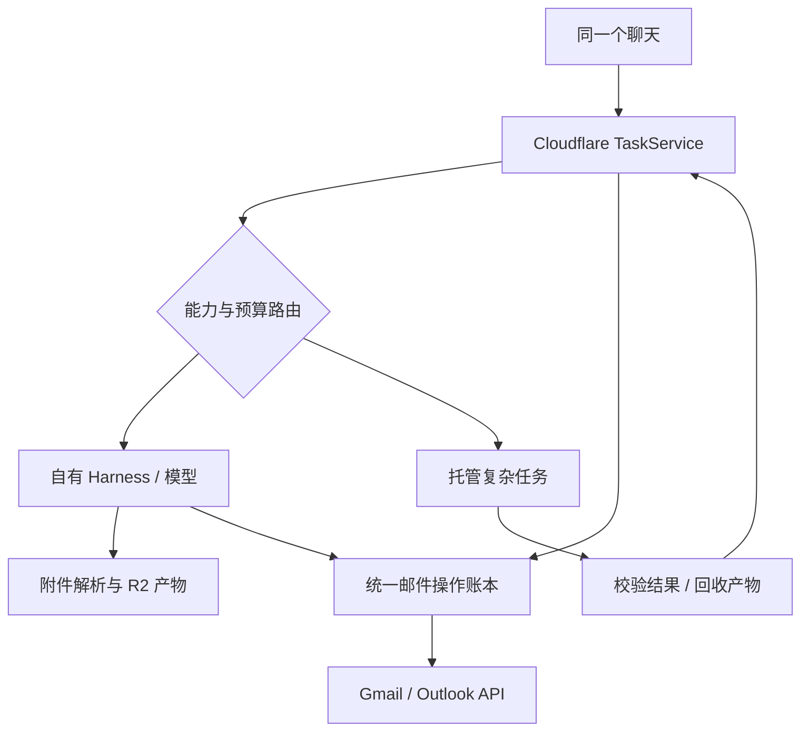

# Maco 附件理解与复杂任务执行策略

状态：**设计方案，尚未实现或部署。** 核对日期：2026-11-19。本文补充[完整后端迁移方案](full-backend-migration.md)，不改变当前 v0.3 的运行能力。

## 1. 已确认的产品决定

- 邮件摘要、分类已经使用端侧 AI。Worker 接收并同步结果，退出旧 OpenAI 专用推理；这不影响 Harness 的任务上下文压缩、账户事实和长期偏好。
- 日常邮件助理使用 Cloudflare 上的自有 Harness；常规邮件 API 操作不启动沙盒。
- 复杂附件、计算和资料整合任务可以按需委派托管 Agent API。优先裁剪复用现有能力，再根据实际使用量增加专门解析器。
- 所有 Gmail / Outlook 支持的修改仍由 Cloudflare 的统一操作账本调用供应商 API。托管子任务返回分析、草稿内容或动作提案，不能直接修改邮箱。
- 聊天、任务、授权、记忆、同步和资产归 Maco；模型与托管执行器均可替换。

“移除日常沙盒依赖”与“复杂任务可以使用托管环境”同时成立。需要自建的是稳定的任务边界，不是自己维护 LibreOffice、Python 或 GPU 服务。

## 2. 三种能力分别封装

| 能力 | 接口职责 | 输入与输出 | 典型用途 |
| --- | --- | --- | --- |
| ModelAdapter | 一轮模型生成/工具调用 | 中立消息 → 文本、工具请求、usage | 搜邮件、理解正文、写回复、选择下一步 |
| AttachmentParser | 将文件变成可复用数据 | 授权附件引用 → 文本、表格、图片、覆盖范围 | PDF/Office 提取、扫描 OCR |
| ManagedExecutor | 执行一项可能耗时的工作 | 有界任务包 → 状态、结果、产物、usage | 多文件对账、复杂表格计算、文档比对、生成附件 |

普通多轮推理不等于必须委派。自有 Harness 本来就能进行多步邮件检索与工具调用；委派依据是本地能力缺口、计算需求、文件处理需求与预算，而不是“邮件数多”或“用户说复杂”。



这是可选分支，不是每次请求依次经过的三段代理。常规请求走 App → Cloudflare → 模型 → Cloudflare → App；委派请求才访问托管执行器。手机断网或关闭后，任务仍可由云端恢复，结果通过原聊天事件同步。

## 3. DeepSeek Harness 实际借鉴什么

本次固定到 [deepseek-harness@2e39e704](https://github.com/deepseek-ai/deepseek-harness/tree/2e39e70496aa02986ca6a820c5d497e816b69d7e)，不能把它与 DeepSeek 的托管 OCR / Files 服务当成同一产品。

### 附件引用与按需工具

普通文件保存原始字节，模型先得到文件名、大小、digest 与可读取路径；公共 LLM 层把 FileBlock 转成引用文字。Maco 借鉴这一分离：用用户授权下的 `attachmentId` 替换宿主路径，需要时再读取指定内容。见[附件层](https://github.com/deepseek-ai/deepseek-harness/blob/2e39e70496aa02986ca6a820c5d497e816b69d7e/packages/attachment/attachment/README.md)及[文件投影实现](https://github.com/deepseek-ai/deepseek-harness/blob/2e39e70496aa02986ca6a820c5d497e816b69d7e/packages/llm/llm/src/content.ts#L145-L209)。

### Office/PDF 处理依赖宿主环境

当前已有 Office 渲染、转换和工作簿重算。Office Kit 在 Host 上运行，使用原生 LibreOffice 或 Node WASM；渲染后把选定页转成图片交给支持图片的模型。这不证明整套引擎可以直接部署 Workers。Maco 借鉴选页、输出上限、版本和缓存接口，把重处理交给托管服务。见 [Office Kit](https://github.com/deepseek-ai/deepseek-harness/blob/2e39e70496aa02986ca6a820c5d497e816b69d7e/packages/document/office-kit/README.md)与[模型图片能力检查](https://github.com/deepseek-ai/deepseek-harness/blob/2e39e70496aa02986ca6a820c5d497e816b69d7e/packages/document/tool-office/src/index.ts#L307-L350)。

### Files 集成不等于通用文档解析

本次所审调用链中的 DeepSeek Files API 用于上传、复用规范化图片；普通 PDF/Office 仍先成为文件引用。未在该调用链中发现专用 OCR API 调用。见 [DeepSeek adapter](https://github.com/deepseek-ai/deepseek-harness/blob/2e39e70496aa02986ca6a820c5d497e816b69d7e/packages/llm/llm-deepseek/README.md#L101-L109)。

## 4. 附件解析供应商与首轮选型

以下为官方公开能力与价格，未用真实附件做质量或延迟对比。

| 路径 | 当前适用范围 | Maco 获得的产物 | 选型判断 |
| --- | --- | --- | --- |
| Worker 有界读取 | TXT / Markdown / CSV / JSON 等 | 文本、结构化数据 | 最轻路径；CSV 按行/列处理，避免大表整份塞进模型 |
| Cloudflare `toMarkdown` | 文本 PDF、DOCX、XLS/XLSX 等公布格式；未列 DOC/PPT/PPTX | Markdown / text | 首轮的普通文件路径；不把图片描述当忠实 OCR |
| DeepSeek 独立 OCR | PDF、DOC/DOCX、PPT/PPTX、图片；公布列表未列 XLS/XLSX | 可导出的 `pages[].text` | 文字提取的成本优化候选；布局标记需正规化 |
| Mistral OCR 4.1 | PDF、Word、PowerPoint、XLSX/CSV、图片等 | 分页 Markdown、表格、图片及可选块信息 | 需要较丰富解析产物时的候选；固定模型版本 |
| 托管 Agent 执行器 | 由具体环境与工具决定 | 任务答案、分析结果，或可回收文件 | 首轮承接复杂文件任务；不因有上传接口就宣称所有格式可理解 |

Cloudflare 官方说明 PDF 读取结构树/已有文字，图片路径生成描述；大部分转换免费，使用 Workers AI 的转换可能产生推理费用。[处理原理](https://developers.cloudflare.com/workers-ai/features/markdown-conversion/how-it-works/)、[格式](https://developers.cloudflare.com/workers-ai/features/markdown-conversion/supported-formats/)、[定价说明](https://developers.cloudflare.com/workers-ai/features/markdown-conversion/)。独立转换文档未给出可据以承诺的固定页数上限或延迟 SLA；Maco 自己限制输入并实测。

| 独立 OCR | 当前公开单价 | 官方输入上限 | 影响调度的限制 |
| --- | --- | --- | --- |
| DeepSeek | USD 0.225 / 1,000 页 | 100 MiB、1,000 页 | 每供应商账户 15 个并发；总请求预算 180 秒 |
| Mistral OCR 4.1 | USD 4 / 1,000 页 | 50 MB、1,000 页 | 具体速率按组织配额；同步 API 与异步 batch 分开 |

来源：[DeepSeek 价格](https://api-docs.deepseek.com/quick_start/pricing/)、[OCR guide](https://api-docs.deepseek.com/guides/ocr/)、[Mistral 型号与价格](https://docs.mistral.ai/models/ocr-4-1)、[完整格式与限制 FAQ](https://docs.mistral.ai/studio/document-processing/basic_ocr.md)。10,000 页按上述普通解析单价分别为 USD 2.25 和 USD 40；这是算术示例，不含模型推理、存储、重复请求，也不表示质量相同。

DeepSeek 独立 OCR 可导出文字；DeepSeek Files 解析后的原文件和结果不可下载，只能使用供应商 file ID 引用，因此不能作为 Maco 跨模型的唯一解析产物。[Files 边界](https://api-docs.deepseek.com/guides/files_api/)。Mistral 的[分页 API](https://docs.mistral.ai/api/endpoint/ocr)提供独立输出，适合正规化缓存。

Cloudflare AI Search 也已有扫描 OCR，但它属于索引服务；不等于独立 `toMarkdown`，也不应把该服务的文件上限混用到转换 API。本轮不为即时附件额外建设整套索引流程；以后确有附件全文检索需求再评估。[AI Search OCR](https://developers.cloudflare.com/ai-search/configuration/data-source/)

**首轮建议：有界文本读取 + `toMarkdown` + 一个受控托管执行器。** 先完成迁移和真实格式验收；按请求量再选接 DeepSeek OCR 或 Mistral OCR。扫描件若未在该执行器中通过 OCR/视觉验收，就提前接一个 OCR adapter；安装 `pypdf` 本身不能证明能读扫描件。即使加上 OCR，也只需对该分支调用一次解析服务，无需增加常驻服务器。

## 5. 复杂任务委派协议

以下是接口草案，不是仓库当前已实现的类型。

```ts
type DelegatedTask = {
  taskId: string;
  parentTaskId: string;
  conversationId: string;
  runVersion: number;
  accountEpoch: number;
  scopeRef: string;
  policyVersion: string;
  executorProfileId: string;
  instruction: string;
  inputRefs: AuthorizedAssetRef[];
  contextRef?: string;
  outputContract: string;
  limits: { deadlineAt: number; maxOutputBytes: number; budgetPolicyId: string };
  operationPolicy: 'propose_only';
};

interface ManagedExecutor {
  submit(task: DelegatedTask): Promise<RemoteTaskRef>;
  inspect(ref: RemoteTaskRef): Promise<ExecutionStatus>;
  readEvents(ref: RemoteTaskRef, cursor?: string): Promise<ExecutionEvents>;
  cancel(ref: RemoteTaskRef): Promise<CancellationStatus>;
  collect(ref: RemoteTaskRef): Promise<ValidatedResult>;
  cleanup(ref: RemoteTaskRef): Promise<CleanupStatus>;
}
```

### 同一聊天，独立子任务

Cloudflare 生成本地 childTaskId，保存 parentTaskId、conversationId、输入摘要、执行版本及 remoteTaskRef。用户 steer 后递增 runVersion；接纳结果时重新检查该版本、账号/连接授权及历史/记忆的隐私 epoch，不能把旧任务的结果写进新一轮或已遗忘的内容。远端 session 只属于该项工作；同一工作中的续问可按策略复用，跨任务关联通过 Maco 历史和产物完成。禁止为了复用一个 session 把整条用户历史不断发送给托管方。

父任务进入 `waiting_external`，释放本地模型执行槽。其他任务可以继续；同一草稿或邮件资源的修改仍受统一锁与账本管理。远端进度和结果转成同一聊天里的事件，手机无需一直保持连接。

### 默认只读分析，写入由 Maco 执行

托管任务只获得任务所需的文件与上下文。先不授予邮件/MCP 写工具，也不提供 OAuth token、Vault key 或全账户检索能力。需要补资料时，由 Cloudflare 校验并提供受限的只读结果。

例如“比较两个报价表，再给供应商回信”：Cloudflare 读取获准邮件与附件 → 委派比对计算 → 校验产物 → 主任务形成草稿 → 沿现有 Send/审批流程由 MailExecutor 发信。托管结果中的 `approved:true`、工具建议或文件内容不构成授权。

### 路由规则与预算

- 能力预检、MIME/文件签名、输入规模、已有解析覆盖率与明确计算需求优先决定路由，不给每条普通消息额外增加一次 LLM 分类调用。
- 自有模型可请求委派，但服务端决定执行器、许可范围和预算；初期最多一层委派，禁止远端递归拉起其他 Agent。
- 明确需要表格计算/文件生成时直接走适配的执行器，避免先消耗多轮普通模型再失败升级。
- 仅需要读文字时优先缓存或解析器；遇到权限撤销、预算不足、损坏文件、密码文件，不通过换执行器绕过同一失败原因。
- 记录路由原因、排队时间、远端耗时、可见 usage、解析费用、托管环境费用及付款连接。账户预算、任务预算和供应商全局并发分别控制。
- 预算覆盖整个父子任务树；提交前原子预留，完成后结算。远端执行结果未知时保留相应预留，不能释放额度后立即再启动另一项付费工作。
- 预算额度是本地 admission/停止策略；若供应商不支持硬上限或不能即时停止，不能承诺取消瞬间不再计费。

### 持久恢复与结果归属

1. 先持久化 submit intent 与输入 digest，再提交远端。若响应丢失且无法确定远端是否创建成功，标记 `submission_unknown`；核查供应商去重/查询能力后才能重试，不能假设 POST 天然幂等。
2. 已拿 remoteTaskRef 后，回调和轮询都进入同一持久事件入口。校验签名/受限凭据、任务关联、epoch 和事件 ID；重复及乱序事件不得重复完成父任务。
3. 取消、reset、撤销或删除会阻止结果触发后续操作。向供应商请求取消后继续记录远端状态；本地 `cancelled` 不等于远端已停止。
4. 只回收允许类型、体积和数量的输出；校验来源、真实字节和 schema，写入私有 R2 后才向聊天发布 artifactId。模型文字中的“已生成文件”不是文件回收证据。
5. 保存可审计的公开结果与来源，不导入供应商隐藏推理、私有 checkpoint 或远端凭据；迟到结果只做必要状态核对/清理。
6. 失败或未知状态下不并行启动第二执行器，也不重放邮箱修改。允许的重试必须拥有新的 attempt 身份，并与旧 attempt 的结果围栏对应。

## 6. 现有 OpenAI 托管路径如何裁剪复用

旧代码基线：[maco-mail@d1b6dfc](https://github.com/sim-628/maco-mail/tree/d1b6dfc6c77545d60092e6c8f42db43f882f34ff)。这些是代码中的现有集成事实，不是本轮对上游账户权限或可用性的实测。

- 当前集成调用 `/v1/agents/sessions`，带 `OpenAI-Beta: agents=v1`；不是把 Agents SDK 或普通 Responses 调用等同于托管执行器。
- 当前使用 Worker 的 `OPENAI_AGENTS_API_KEY`，不能据此推断它消耗用户 ChatGPT 订阅额度；付款连接和认证方式需单独记录。
- 文档通过 `/v1/files` 上传，再挂入 `/v1/agents/environments`；旧环境配置包含 `pypdf`、`python-docx`、`openpyxl` 等库，可作为复用起点。
- 旧实现把账户 hostContext 与整套工具带入运行，并用共享 session 续接；这些要从附件子任务中剥离。
- 目前旧输出收集主要是 assistant `output_text`。生成文件下载、来源校验和搬回 R2 需新增正式产物通道，不能宣称原有路径已经覆盖文件交付。

依据：[请求客户端](https://github.com/sim-628/maco-mail/blob/d1b6dfc6c77545d60092e6c8f42db43f882f34ff/App/AgentHarness/Cloudflare/managed-agent-client.mjs)、[模型及环境配置](https://github.com/sim-628/maco-mail/blob/d1b6dfc6c77545d60092e6c8f42db43f882f34ff/App/AgentHarness/Cloudflare/managed-agent-model.mjs)、[共享 session](https://github.com/sim-628/maco-mail/blob/d1b6dfc6c77545d60092e6c8f42db43f882f34ff/App/AgentHarness/Cloudflare/managed-agent-sessions.mjs)、[输出过滤](https://github.com/sim-628/maco-mail/blob/d1b6dfc6c77545d60092e6c8f42db43f882f34ff/App/AgentHarness/Cloudflare/managed-agent-output.mjs)。

复用目标是提交/状态/文件输入/文本结果等底层能力。上线前必须把临时 session、受限工具、取消语义、回调验签、产物回收、清理和独立计费逐项验收；旧默认配置不能直接成为新执行器配置。

已有的创建 intent 核对、流断线后查询、公开输出去重、webhook 验签和 usage 补账可作为实现起点。新注册表必须按 delegation 管理，取消与清理分别持久化；先发取消，不因清理文件失败而推迟停止计算。成本按真实型号、tokens 与环境项目核算，不沿用旧固定单模型公式。

旧账号主运行时开关与新托管委派许可分开控制；允许一个附件子任务不能重新激活旧全局 scheduler。上线前用当前授权账户验证所需 API 与环境仍可用，未通过的产物导出能力不进入已支持清单。

## 7. 附件资产与多用户隔离

### 自有数据对象

| 数据 | 位置与内容 |
| --- | --- |
| 附件元数据 | 用户 DO：用户/邮箱/消息/附件 ID、原件版本、MIME、字节数、digest、权限 epoch |
| 原始附件 | 私有 R2，保留现有资产权限、加密和分块兼容 |
| 解析产物 | R2：文本、表格、必要图片；DO 保存产物引用、状态与索引 |
| 解析覆盖 | 与调用状态分开：complete / partial / unverified，已识别范围、缺页、截断、警告、parser/version/options；失败另记录 failed |
| 委派任务 | DO：父子 task、attempt、remoteTaskRef、预算、事件 cursor、取消与清理状态 |

缓存键至少包含用户隔离域、原件 digest、parser 版本和选项。命中缓存仍重新验证当前邮箱授权与删除状态。页码/表格范围仅保存解析器真实提供的信息；无法证明页码时使用文本片段引用，不编造页引用。

转换成功不等于完整覆盖。无法证明全文覆盖时标记 `unverified`，只有覆盖证据满足要求才标记 `complete`；混合 PDF 提取到了文字页，也可能遗漏扫描页。

模型工具可规划为 `attachment_list`、`attachment_read`、`attachment_search`：只返回有限页/范围与来源；图片输入另受像素与模型能力限制。读取完整文件后，也不能把全文重复加进每轮上下文。

旧 R2 对象可能是加密分块；外部服务需要经授权重组/解密后的内容，不能向其提供指向密文的 URL。可采用有界直接上传，或短时、单资产的受限下载能力；签名 URL/下载凭据不写进聊天或日志。远端副本的生命周期另行管理，删除 R2 不代表远端副本已删除。

### 解析任务单独调度

首次解析是持久工作，不用模型反复轮询文件。解析就绪后恢复等待 task；解析器并发额度和供应商账户级限额不放进每个用户 DO 各自独立放行。多用户等待同一用户内同一解析任务可去重，但不能跨用户泄露内容。

当前[调度器](../src/scheduler.mjs)给普通 task 的执行窗口为 120 秒、maintenance 为 60 秒；不能直接包住可能更长的托管计算或 OCR。应新增持久委派账本及 `waiting_external`，恢复时检查已有 remoteTaskRef，不能把外部正在运行的工作简单重排为新的 submit。解析/委派使用独立 deadline 与排队策略。优先沿用统一账号调度及持久 job；确有吞吐需要时增加 Cloudflare Queue / Workflow 等后台承载，不增加普通消息的串行转发层。

DeepSeek OCR 的空行保活后才返回最终 JSON，并非逐页 SSE；HTTP 200 仍须检查错误，页级 `finish_reason:length` 表示截断。连接断开不取消远端识别，不能立刻盲目重发。[OCR 响应与错误](https://api-docs.deepseek.com/api/ocr/)、[请求生命周期](https://api-docs.deepseek.com/guides/ocr/)

独立 OCR 不写入某供应商 Files 服务，并不等于零保留。使用第三方解析前，按实际账户条款配置数据保留；Mistral `/v1/ocr` 可在获批且启用的 ZDR 范围内，但 Files、Agents、batch 文件不在该范围。[Mistral ZDR](https://docs.mistral.ai/admin/monitor-comply/zero-data-retention)

## 8. 简单用户配置与完整内部配置

普通用户仍只需选择 provider / model / effort 和对应连接。API key 存 Vault，任务只持 connectionId。是否允许使用其他供应商处理附件或托管子任务，是一次明确的账户/产品策略；不能因主模型配置了 key 就默认它也授权其他供应商或代付费用。

内部保留三个注册表：ModelRegistry、ParserRegistry、ExecutorRegistry。主模型不支持图片时可以消费 OCR 文字；需要图表视觉判断时选择已许可的视觉能力或返回缺口。托管执行器可能只支持自己的模型，它的 provider/model/payer 必须单独记录，不能谎报整项任务都使用了用户所选模型。

聊天 ID、任务 ID、供应商 session ID、文件 ID、记忆范围彼此独立。这样既可在一个聊天持续工作，也不会让一个永久托管 session 决定全账户的执行速度和历史成本。

## 9. 实施顺序与完成门槛

| 阶段 | 交付 | 必须通过的验证 |
| --- | --- | --- |
| 1 | 纠正迁移边界，保留端侧摘要/分类结果同步 | 云端没有默认回退推理；未同步结果状态可解释；任务压缩仍有效 |
| 2 | AttachmentService、R2 权限/缓存、有界读取与 `toMarkdown` | 验证文本 PDF、DOCX、XLSX 提取质量；混合扫描 PDF 不因输出非空而标记完整，覆盖未确认时进入待处理分支 |
| 3 | 裁剪现有托管 API 为一个 ManagedExecutor | 无全账户工具/共享长期 session；提交未知、取消、迟到/重复结果、多端重连均正确；扫描件经视觉/OCR 实测后才声明支持 |
| 4 | 产物回收及组合任务 | 两份表格对账生成文件、返回同一聊天、再沿原授权发信；远端没有第二邮件写入路径 |
| 5 | 根据实际流量增加独立 OCR | 比较中英文、扫描质量、表格数值和顺序、P50/P95、每次成功费用后决定默认分流 |

第一阶段不要求同时接入所有 OCR 厂商，也不承诺所有二进制格式都可处理。当前接收文件的体积上限继续作为产品边界，只有完成 Worker 内存、解压、解析及远端输入验证后才提升。

验收记录同时关注首个有效进度、最终答案延迟、缓存命中、结果完整性和成功任务总成本。托管执行器可能提高复杂任务的完成率，但没有实测前不能保证更快或更便宜。

本次仅更新策略文档，未发送用户附件、调用计费解析、修改运行代码、修改 App 或部署 Worker。
