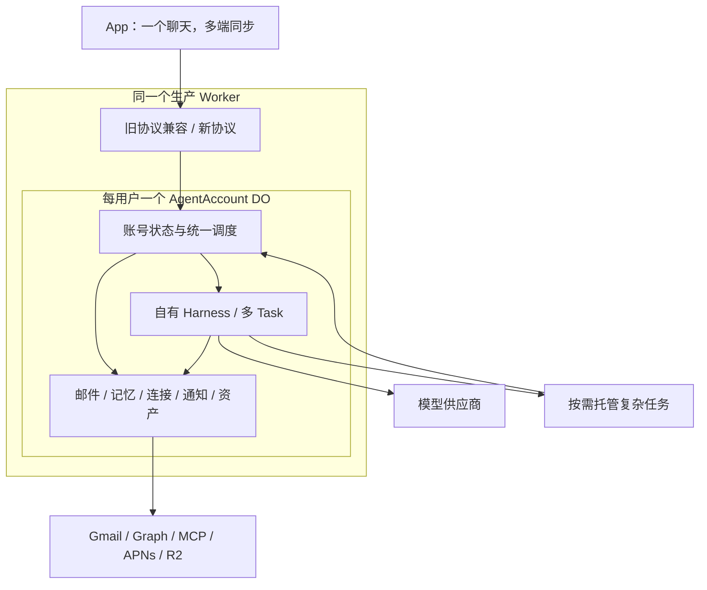

# Maco 完整后端迁移方案

**状态更新（2026-11-19）：本文保留 v0.3 审计形成的“沿用旧生产身份、原址接替完整后端”历史方案，供后续生产迁移参考。它不是当前 v0.4 的部署指南。** 用户现已选择先独立部署新的 `maco-harness`，再改造 App；当前已实现能力与条件以 [README](../README.md)、[客户端协议](protocol.md)、[Cloudflare 部署](cloudflare-deploy.md)为准。

v0.4 已有自有 Harness、多个 Task/服务端会话聚合、R2 资产、受限 MCP、可选托管子任务、通知与账户清理。当前没有旧数据/凭据自动导入器、旧 `/v1/chat` 兼容门面或 `AgentAccount` 原址组合构建，不会自动继承 `maco-agent-cloud` 的资源；本仓库也尚未替用户完成部署或客户端切流。

**下文的“当前 v0.3”“拟实现”“尚未实现”及矩阵是固定历史基线的审查结论。** 保留它们用于评估旧能力如何接替，不代表 v0.4 所列新功能仍全部缺失。尤其第 2 节的保留旧 Worker/namespace 建议属于另行设计和验收的迁移，不可直接套用当前独立部署配置。

代码基线：旧 [maco-mail@d1b6dfc](https://github.com/sim-628/maco-mail/tree/d1b6dfc6c77545d60092e6c8f42db43f882f34ff)，新 [maco-harness@fae8b5e](https://github.com/sim-628/maco-harness/tree/fae8b5e0731d1e2d0fe8fd50bdb1ac7915d5b06f)。核对日期：2026-11-19。

本方案用于评估“新仓库承接旧生产后端”的完整性目标。[原迁移说明](migration.md)保留操作归属、数据边界与切流原则。当前 `wrangler.jsonc` 部署独立 `MacoAgent` 与 `NotificationRegistry`，不能改一个 Worker 名称就覆盖旧生产服务。

2026-11-19 产品决策更新：用户确认邮件摘要与分类已采用端侧 AI；云端承接结果同步，不重建这两项推理。复杂附件和计算任务允许按需委派托管 Agent API。详细边界见[附件理解与复杂任务执行策略](attachments-and-managed-execution.md)。以下目标已按这两项决定修正。

## 1. 最终交付目标

1. 一个生产 Worker 承接旧账号、聊天、邮箱、连接、文件、通知接口，并运行自有 Harness。
2. 每个用户沿用一个权威 `AgentAccount` Durable Object；其中有多个独立 Task，不再依赖一个长期托管模型 session。
3. App 与 Agent 的邮箱修改都进入同一云端操作账本；App 保留阅读、编辑、审批、待执行展示与结果同步。
4. 自有 Harness 的模型循环、任务上下文压缩统一经过 provider adapter；邮件摘要与分类由端侧 AI 完成，Worker 负责结果同步。`provider / model / effort / connectionId` 描述模型配置，连接凭据由服务端管理。
5. 原账号、旧聊天、邮件引用、邮箱与 MCP 授权、文件、定时邮件、使用量和删除行为有明确的继承与验收规则。
6. 常规请求直接进入 Cloudflare，再访问模型供应商；复杂任务由同一 TaskService 按需委派托管执行器。业务状态、聊天、权限与外部操作仍由 Cloudflare 管理，常规请求不经过托管执行器。
7. Supabase 保留登录、Passkey、身份与会话撤销控制。若将原 Supabase push / ancillary-model 业务也迁入 Cloudflare，其存储和调度必须真正接替，不能只把旧 RPC 调用换一个目录。

“完整”以当前已存在、可验证的产品能力和用户确认的产品决定为基线。端侧摘要/分类、原生 Apple Translation、系统权限和本地交互继续在 App。日常邮件操作无需沙盒；复杂文件计算可使用供应商托管环境。模型专属的文件输入、图像理解或 effort 参数通过能力适配处理，不能承诺任意模型都有相同能力。

## 2. Worker 和数据的交接方式

### 推荐：新仓库提供完整构建，生产沿用现有服务身份

| 对象 | 处理方式 |
| --- | --- |
| 代码仓库 | 后续完整后端由 `maco-harness` 维护 |
| 联调环境 | 独立 Worker、全新 namespace、测试 OAuth / 邮箱 / 文件，使用完整构建验证 |
| 生产 Worker | 完整验收后沿用 `maco-agent-cloud` 的服务身份与 URL |
| 生产 DO | 保留 `ACCOUNTS → AgentAccount` 与现有 namespace |
| 生产存储 | 保留旧 `documents` / `document_parts`，以兼容的加表方式加入新任务、事件、索引与账本 |
| 私有文件 | 保留 R2 `maco-chat-private`、旧对象路径、密钥和权限检查 |
| 域名及回调 | 保留原通知预览、邮件预览及旧任务清理所需路径；新委派执行使用独立的任务映射、鉴权与回调归属，不能恢复旧全局执行权 |
| 配置 | 生产配置单独审阅，保留旧 DO migration 历史、绑定和密钥；不能复用独立 v0.3 的新建类配置覆盖生产 |

替换代码来源不要求更换服务名。Cloudflare 允许更新现有 DO 类的代码而不创建新 namespace；应用需要保持存储兼容。[DO 类更新说明](https://developers.cloudflare.com/durable-objects/reference/durable-object-class-migrations-legacy/)

若确实要求新的生产服务名，可以另做 namespace transfer。那是服务身份迁移，需要协调部署、绑定、路由与回滚；不与第一次功能替换捆绑。[DO transfer 文档](https://developers.cloudflare.com/durable-objects/reference/durable-objects-migrations/)

Workers 与 DO 的版本发布存在传播窗口，因此旧、新门面都必须与相邻 DO 版本兼容，不能把部署完成等同于所有账号立即采用新协议。[Cloudflare 版本一致性说明](https://developers.cloudflare.com/durable-objects/platform/known-issues/#code-updates)

## 3. 模块边界

以下是拟实现模块，不代表当前仓库已有这些文件或接口。

| 层 | 模块 | 职责 |
| --- | --- | --- |
| 接口 | Router / LegacyProtocol / NativeProtocol | 验证身份，兼容旧请求和 DTO，提供新任务与事件协议 |
| 账号 | AgentAccount / AccountAuthorization | 唯一用户隔离边界，账号状态、session、generation、执行归属 |
| 持久化 | AccountUnitOfWork / SchemaMigration | 一次事务提交命令映射、任务、兼容投影与事件，提交后广播 |
| 调度 | AccountScheduler | 唯一 alarm，管理前台任务、外部操作、定时发送和后台维护 |
| 模型 | ModelRegistry / Harness / TaskService | 中立消息、模型能力、工具循环、取消、上下文压缩与任务预算 |
| 委派 | ExecutionRouter / ManagedExecutor | 按能力和预算选择复杂任务执行器，管理父子任务、远端状态、产物回收与去重 |
| 交互 | InteractionService / WorkItemService | 问题、表单、反应、草稿/附件卡片及工作事项；保存版本化等待与用户回答 |
| 外部操作 | OperationService / MailExecutor / ConnectorExecutor | 审批、冻结负载、幂等、执行与结果未知状态 |
| 连接 | AccountVault / OAuthAdapters | 模型、邮箱、MCP 凭据；一个 refresh owner；权限与撤销版本 |
| 邮箱 | MailReadService / MailIndex / MailAnalysisSync | 原生读取、增量同步、片段索引及端侧摘要/分类结果同步；主动提醒独立调度 |
| 记忆 | HistoryService / MemoryService | 旧新历史检索、账户事实、长期偏好和来源/删除语义 |
| 资产 | AssetService / AttachmentService | R2、上传下载、邮件及聊天附件、内容提取与模型能力适配 |
| 通知 | NotificationService / SubscriptionService | APNs 安装、供应商 webhook、续订、去重、预览及重试 |
| 生命周期 | AccountMigration / AccountErasure | 可恢复交接、导出、聊天 reset、连接撤销、账号删除与清理 |

用户 DO 是状态隔离单位，Task 是执行与上下文单位。独立 Task 可以有受控的并发 I/O；同一邮件/草稿的修改仍串行。一个聊天界面无需将全部历史塞进同一次模型调用。托管子任务只接收所需材料，结果映射回原聊天；供应商 session 不是用户的永久聊天身份。

### 组合时必须解决的四个问题

- **单一 alarm。** 旧 `AgentAccount.alarm` 和新 `ExecutionHost` 都会写 alarm，不能直接一起实例化。索引、结果同步、主动提醒、委派状态检查、清理和旧任务排空接入一个调度器；邮件摘要/分类推理不在云端重建。
- **显式恢复。** 当前新 host 构造时会恢复 running task 和 dispatching operation。组合后的恢复要在 schema、身份、迁移状态就绪后执行，不能因读取兼容接口意外启动另一套执行器。
- **统一事务。** 旧 `db.atomic` 与新 `Store.tx` 需要共享事务边界和提交后的事件队列，避免外层事务回滚后客户端已经收到成功事件。
- **WebSocket 分协议。** 旧客户端接收 changed 提示，新客户端接收 seq 事件；socket attachment 标识协议、session、过期时间。禁止向全部连接广播同一种格式。

## 4. 完整能力清单

“已有基础”仅指新 v0.3 的代码能力，不表示生产、客户端或真实服务已验收。

| 能力 | 新 v0.3 状态 | 全量迁移的交付要求 |
| --- | --- | --- |
| 登录、设备/session 撤销、账号状态 | JWT 验证已有；旧撤销语义缺失 | 统一旧授权策略；HTTP、WS、任务和外部操作都遵守撤销/删除状态 |
| 旧聊天 pull/commit/check、跨端同步 | 新任务/事件已有；旧协议未适配 | 保留旧 DTO、generation/revision/分页/tombstone；投影同一份新执行状态 |
| 自有 Harness、多模型、多 Task | 已有基础 | 旧 runSubmit/List/Cancel 映射到新 Task；常规任务脱离托管 session，复杂任务可显式创建受控的托管子任务 |
| 问答、表单、反应、卡片与工作事项 | 未完整承接旧工具 | 保留 ask_user、request_form、chat_react、work_item 及旧 UI 交互；回答绑定原任务和交互版本，多端不会重复恢复执行 |
| 无邮箱、单邮箱、跨邮箱任务 | 当前强制一个 mailboxId | 支持服务端验证的 mailbox / connector 集合；旧 App 最多 20 个 live mailbox 的任务不能退化成单邮箱 |
| 原生邮箱读取 | 有工具读取与片段索引 | 补全 folders、收件箱 delta、旧邮件分页、全文搜索、正文、附件、原始 MIME、别名等 App 读取合约 |
| 手动和 Agent 邮件修改 | 新操作账本已有 | App 的已读、归档、移动、删除等全部提交同一云端命令；设备不再直写 |
| 草稿、即时发送、Undo Send | 新审批与定时操作已有 | 保留现有草稿卡片；Send 点击授权冻结内容；Undo 取消云端派发，设备计时器只控制显示 |
| Send Later | 新定时 operation 已有 | 旧排程一次性归入同一账本或由唯一兼容执行路径排空；禁止两套 scheduler 重发 |
| 邮件摘要、分类及其派生展示 | 用户确认已采用端侧 AI | 保留结果上传、版本、同步和通知预览消费；退出旧 OpenAI 专用推理路径，不默默增加云端 fallback |
| 主动巡查、任务级提醒 | 未完整承接 | 与端侧分类分开验收；需要云端 Agent 的部分使用通用模型层与独立预算 |
| 模型配置、使用量、成本 | 新模型连接/usage 基础已有 | 保留旧 usage 接口和历史回执；按真实 provider/model/payer 与费率来源计量，不能沿用固定单模型成本假设 |
| 邮箱 OAuth / 刷新 / scope | 新连接库已有 | 兼容旧 grant/clientID/真实账号身份；旧新接口使用同一凭据 owner；不复制两份 refresh token 并行刷新 |
| Notion / 现有 MCP 连接与工具 | 当前无通用 MCP | 移入连接管理、工具发现与策略；云端执行进入统一 operation 状态机，保留审批和不明结果约束 |
| R2 上传、下载、旧附件引用 | 当前无旧资产服务 | 保留旧文件路径、访问权限、分块和实际文件范围；下载成功不能代替文件内容理解验收 |
| 图片、PDF、Office 等资料理解 | 当前主要是文本/工具消息 | 独立 AttachmentService；轻量解析/视觉、可替换 OCR、按需托管复杂分析；同一聊天可恢复并回收产物 |
| Push、订阅续订、预览、内部 relay | 未接替 | 旧 Worker 合约全部保留；完整 APNs/provider 业务从 Supabase 迁入时一并迁状态、去重、调度和回执 |
| 跨历史任务检索 | 仅新 DO 历史 | 旧记录通过白名单投影接入新检索；保持来源、引用、时间、授权范围和覆盖信息 |
| 稳定账户事实、长期偏好 | 已有基础 | 迁入已确认内容；旧推测仍为提案，不重新把全部旧消息当新用户输入学习 |
| 旧结构化记忆与 continuity 对象 | 不与新 fact/preference 自动等价 | 保留既有读取、编辑、重命名、删除、版本与来源；工作事项不能被压成一条无结构的偏好 |
| 导出、reset、账号删除 | 尚无完整旧生命周期 | 覆盖新旧状态、连接、操作、R2 和历史索引；保留 reset 与账号删除的不同语义 |
| 域名/AASA、头像公开配置 | 在其他现有 Worker | 若收敛部署则保留等效路径；不能因换后端破坏 Passkey/AASA；头像图片仍可直达 CDN |
| Apple Translation、系统权限、本地展示 | 原生能力 | 保留 App 实现，无需搬入 Worker |

旧服务依据：[账号模块](https://github.com/sim-628/maco-mail/blob/d1b6dfc6c77545d60092e6c8f42db43f882f34ff/App/AgentHarness/Cloudflare/account-worker.mjs)、[邮件写入入口](https://github.com/sim-628/maco-mail/blob/d1b6dfc6c77545d60092e6c8f42db43f882f34ff/App/MacoMail/Sources/MailAppStore.swift)、[供应商推送](https://github.com/sim-628/maco-mail/tree/d1b6dfc6c77545d60092e6c8f42db43f882f34ff/App/Supabase/functions/maco-push)。新基础依据：[服务组合](../src/service.mjs)、[调度器](../src/scheduler.mjs)、[当前限制](../README.md)。

旧交互/工作事项工具依据：[runner](https://github.com/sim-628/maco-mail/blob/d1b6dfc6c77545d60092e6c8f42db43f882f34ff/App/AgentHarness/Server/runner.mjs#L413-L550)。审批只负责批准云端动作；用户问答/表单是独立的任务等待状态，不混用设备执行任务。

## 5. 统一连接和权限

同一 `AccountVault` 接口可以兼容旧、新两种密文格式，但只允许一个模块拥有刷新与撤销的写权限。

1. 首先保留旧 mailbox / connector UUID、providerUserID、OAuth clientID、grant 和旧加密 keyring。需要时通过 adapter 注入新 `AgentService`，不为迁移先复制一份可独立刷新的凭据。
2. 旧 native OAuth grant 和新 server OAuth flow 使用各自正确的 client/refresh 策略。能按原协议继续刷新时无需强制所有用户重新授权；改变 OAuth client、扩大 scope 或撤销旧设备授权时再重新授权。
3. 连接别名映射必须以 Supabase 用户和供应商真实账号身份校验，不仅按邮箱显示地址匹配。
4. 模型、邮箱、MCP 是不同连接种类。模型任务只持连接引用；密钥和 refresh token 不进入聊天、工具参数、事件或日志。
5. 任务保存服务端验证的 mailbox/connector scope 集合；工具明确指定目标连接，派发前再次检查权限和 epoch。移除一个邮箱不能因旧 Task 仍持 ID 而继续访问。
6. 旧公开 mailboxToken 不能继续向已迁客户端提供带写权限的 bearer。新 App 通过 CloudMailService 读取和同步，通过 CloudMailCommandClient 修改。
7. 推送续订需要凭据时通过受限内部接口调用同一权威连接层；内部服务权限不能退化为任意客户端可取 token。

旧 grant 的原格式可以被兼容层读取，不意味着现有 v0.3 已支持此 adapter；当前独立 Vault 不接受直接导入旧密文。

## 6. 统一执行、操作账本和后台工作

### Task scope 与模型配置

支持无邮箱任务（账户事实、历史或独立 connector）、单邮箱任务和跨邮箱任务。每次工具调用只使用任务授权集合内的连接，历史检索也遵守同一范围和撤销状态。模型公共历史使用中立格式，provider 私有续接只在兼容的 provider/model/connection 范围内使用。

邮件摘要、分类已由端侧 AI 完成。云端只接受带来源、邮件版本和分析版本的结果，处理幂等更新、跨端冲突及通知预览；结果尚未同步时标为待补齐，不能暗中调用 OpenAI 专用接口补做推理。旧 `mail-decisions.mjs` 作为退役路径检查，不能因为旧源码仍有实现而重新列为云端开发需求。[旧分类实现](https://github.com/sim-628/maco-mail/blob/d1b6dfc6c77545d60092e6c8f42db43f882f34ff/App/AgentHarness/Cloudflare/mail-decisions.mjs)

Harness 的任务上下文压缩、跨任务记忆与云端主动任务仍是独立能力，不等于邮件摘要。需要模型的部分使用通用注册表与各自预算。

复杂任务使用 `ManagedExecutor`。模型 adapter 表示一次模型调用；执行器 adapter 表示可异步恢复的整项工作，两者配置分开。初期可裁剪复用现有 OpenAI 托管文档路径，禁止继承全账户工具、全账户共享的永久 session 或邮箱修改权。任务只返回结果/产物/动作提案；真正的邮箱修改进入同一个 OperationService。详见[委派协议与复用缺口](attachments-and-managed-execution.md#5-复杂任务委派协议)。

旧 token 成本实现存在固定输入/输出费率。迁移保留历史回执，新增 usage 必须注明 provider、model、payer、实际 token/cache usage 与价格来源；供应商未返回的数据保持未知或明确估算。[旧成本实现](https://github.com/sim-628/maco-mail/blob/d1b6dfc6c77545d60092e6c8f42db43f882f34ff/App/AgentHarness/Cloudflare/token-usage.mjs)

### OperationService

- 用 `kind=mail|connector` 等明确类型分派；邮件 revision 与 index invalidation 留在 MailExecutor，不让 MCP 操作误走邮箱逻辑。
- 已支持的 Gmail/Graph 修改如果由 MCP 再次暴露，必须归一到 MailExecutor，或禁止重复的写工具；不能通过 connector 类型绕过邮件资源锁、revision 和审批。MCP 自报 readOnly/approval 注释不能替代服务端授权策略。
- 旧 mutation/draft/schedule/device operation ID 映射到唯一 operationID，并记录冻结 payload digest。旧新协议的重复提交指向同一操作。
- 审批绑定连接 epoch、动作/tool、准确参数和内容版本。用户点击现有 Send 卡片即可批准相应内容，避免重复确认；客户端自填 `approved:true` 不能替代服务端授权。
- 派发前持久化 dispatching。超时或重建不能证明未执行时进入 unknown，不自动重放。
- 新旧定时接口都引用同一账本。旧发送状态必须逐条判断，不能将 sending、submitted、submissionUnknown 重新排成待发送。
- 所有模型/工具/邮件行为都服从账号执行归属与任务取消。旧全局 managed runtime 仅排空既有任务；新的受控托管子任务由 native TaskService 管理。取消本地等待不代表远端已停止，迟到结果不能恢复已撤销的写权限。

### 凭据隔离的实际边界

服务端拒绝旧 token 请求，不能立即撤销已被供应商签发的 bearer。旧设备还可能保留本地 OAuth grant。切换前需确认设备升级、离线队列和旧授权处理；涉及 provider-wide 撤销时同步验证新连接与推送续订，不以 App 的短缓存时间代替 token 真实有效期。

## 7. 历史、记忆和资产

### 旧新历史共同可搜

保留旧加密原档及其 generation/revision，增量建立公开历史投影。索引通过 `sourceSystem + sourceID + generation + revision` 幂等更新，保留邮件引用、可证明的时间和 scope。新消息到旧 UI 的投影也记录源标记，避免再次被导入成另一条历史。

迁移只能显式允许公开字段。当前 `publicMessage()` 只剔除有限字段；不能将旧对象整包复制进新 messages，尤其不能让 `providerPrivateState`、托管 session/checkpoint、隐藏推理或凭据进入 API、索引和新模型上下文。

旧聊天 reset、删除记忆、连接撤销、账号删除与新 history/memory epoch 联动。导入器读取源版本与删除状态，防止将已经删除的内容重新导入。旧偏好不通过批量 `memory.observe()` 重新推断；已确认事实、明确偏好和待确认提案分别保留来源与状态。

### 资产与文件理解分别验收

旧代码接受的聊天文件上限包含 4 个文件、单个 10 MB、4 MB 分块；旧定时发送附件又是另一套限制。当前新 Harness 的小型文本附件和外发附件限制不能直接替代这些合约。

完整保留包括上传、下载、引用、权限、内容读取、模型理解和外发引用。旧托管模型遇到文档输入会配置 OpenAI hosted 环境及文档库；原生 OpenAI 文件输入也是另一条 provider 专属路径。保留 R2 不会自动迁入这些理解能力。[旧托管文档路径](https://github.com/sim-628/maco-mail/blob/d1b6dfc6c77545d60092e6c8f42db43f882f34ff/App/AgentHarness/Cloudflare/managed-agent-model.mjs)

目标 `AttachmentService` 使用受限内容提取和模型视觉/文档 adapter：限制文件体积、解压量、页数、CPU 和输出预算；声明解析范围；能力不足时按策略委派托管执行器或返回明确结果。文件作为对象引用传递，不把大文件塞进普通 command JSON。日常路径不启动沙盒；复杂计算若需要，使用托管子任务的临时环境。原件与可复用解析产物归 R2，供应商 file/session ID 仅为适配器内部引用。[附件理解与复杂任务执行策略](attachments-and-managed-execution.md)

## 8. App 最小改造

先保留现有界面和 DTO，替换网络与执行边界。

| 改造 | 结果 |
| --- | --- |
| 统一 BackendConfiguration | App、AgentHarness、通知 Extension 共用后端 origin 与支持的协议 |
| LegacyProtocol 兼容投影 | CloudRun、ChatCloudSnapshot、草稿卡片、summary、usage 等旧 UI 可继续解码；分页/revision 必须真实一致 |
| CloudMailService | 提供 folders、sync/delta、历史、搜索、正文、原始 MIME 和附件下载；保持现有读界面 |
| CloudMailCommandClient | 使用 PendingMutation.id、draft operationID 等持久身份提交/取消/对账，重试不生成新 ID |
| 发送与 Undo | Send 进入云端冻结操作；Undo 取消云端派发；本地 timer 不再调用 provider.send |
| 设备步骤 | 云端支持的邮件/MCP操作不再通过 runDeviceClaim 在手机执行；保留必要的原生交互 |
| ID/cursor 适配 | 保留本地 mailbox/mail UUID 和旧引用；provider cursor、历史分页 cursor、新索引 cursor 分别管理 |

旧 `/v1/events` 与当前新 Harness `/v1/events` 语义冲突。完整构建应保留旧 `/v1/*`，为新门面规划独立 `/v2/*` 路由；路径版本与消息 protocolVersion 明确协商。**此路由设计尚未落地，当前 v0.3 仍使用 docs/protocol.md 中的 `/v1/*`。**

原生 MailService 的 mutate/send 签名没有持久 commandId，不能只在方法内部转发 HTTP 就宣称完成幂等迁移。只读服务与写命令接口分开，acknowledge 以确定的云端回执为准。[旧 MailService](https://github.com/sim-628/maco-mail/blob/d1b6dfc6c77545d60092e6c8f42db43f882f34ff/App/MailCore/Sources/MailCore/Adapters.swift#L55-L73)

## 9. 旧 Worker 之外的依赖

完整产品迁移需要另外检查这些现有部署，不能仅打包旧 Worker 入口的依赖文件：

- **Supabase Auth / Passkey / devices**：保留身份控制面；新 Worker 尊重 session 与设备撤销结果。
- **Supabase maco-push**：APNs 安装、通知 outbox、Gmail watch、Graph subscription、续订和去重。若迁 Cloudflare，需要替换其数据库 RPC 与后台调度，并验证真实 APNs 网络调用。
- **Supabase maco-chat / Gateway**：退役已由端侧接替的邮件摘要/分类推理；结果同步合约保留。其余 review、continuity 等实际仍需云端运行的功能分别接入统一模型层，避免按旧模块名整包迁移。
- **macomail.app 网站 Worker**：保留 AASA 与固定 provider callback 路径；接管 webhook 后直接进入对应服务，退出旧 Supabase push 代理。
- **头像配置 Worker**：可合并公开配置接口；CDN 图片无需全部经过用户 DO。
- **原生能力**：摘要、分类与 Apple Translation 翻译继续在设备执行；云端只承接必要结果，不重建这些推理。

Supabase push / ancillary-model 的完整迁入属于全量目标；它们的退出条件要单独记录。在完成之前可以保留过渡调用，但不得宣称 Supabase 已仅承担 Auth。

依据：[maco-push](https://github.com/sim-628/maco-mail/tree/d1b6dfc6c77545d60092e6c8f42db43f882f34ff/App/Supabase/functions/maco-push)、[HostedMacoService](https://github.com/sim-628/maco-mail/blob/d1b6dfc6c77545d60092e6c8f42db43f882f34ff/App/AgentHarness/Sources/AgentHarness/HostedMacoService.swift)、[网站 Worker](https://github.com/sim-628/maco-mail/blob/d1b6dfc6c77545d60092e6c8f42db43f882f34ff/App/Cloudflare/src/index.js)、[原生翻译](https://github.com/sim-628/maco-mail/blob/d1b6dfc6c77545d60092e6c8f42db43f882f34ff/App/MacoMail/Sources/MailTranslation.swift)。

## 10. 实施顺序与完成证据

| 顺序 | 交付范围 | 必须证明的结果 |
| --- | --- | --- |
| 1 | 完整 Worker 壳、旧合约、授权、schema 与资产读取 | 旧账号 fixture 可读，撤销语义一致，旧引用/附件可用；独立 staging 不绑定生产数据 |
| 2 | 单一 vault、scheduler、事务和 socket registry | refresh/撤销竞态正确；只有一个 alarm owner；事务回滚不广播成功；两种 WS 不混发 |
| 3 | 跨邮箱 Task、旧 run adapter、通用模型与受控托管子任务 | 两个获准邮箱可使用，第三邮箱被拒；无邮箱任务可运行；模型/托管执行经过各自 adapter，权限、预算与事件归属一致 |
| 4 | 邮件/MCP统一操作账本、旧排程和 App adapter | 旧新协议并发重试只有一次执行；Undo/dispatch竞态正确；不明结果不重发；设备不再直写 |
| 5 | 历史/记忆/附件解析与委派/完整账号生命周期 | 旧历史可搜且导入不重复；私有状态不进入公开面；解析覆盖可验证；子任务结果去重与产物回收；reset/删除覆盖新旧数据、远端引用与R2 |
| 6 | Push、订阅、ancillary-model、usage 和外围路径 | 通知、续订、注销清理、真实附件与使用量合约通过；退出对应旧 Supabase 业务路径 |
| 7 | 真实 staging 全量验收、生产兼容构建与按账号交接 | 测试邮箱/模型/MCP/APNs、多端、旧设备恢复、生产相邻版本兼容均有记录，再切生产代码来源 |

每项能力记录：实现方式（原生/兼容/适配）、协议、状态迁移、配置、fixture 结果、真实服务结果和阻塞项。模块导入成功、接口返回 200、health 正常均不能替代能力验收。

App 需要在 macOS/Xcode 构建并测试；Linux 环境的 Node/workerd 测试不证明 iOS 编译、系统通知或真实 OAuth 已通过。

### 逐账号交接

建议同一用户 DO 保存 `legacy → draining → native` 的状态和递增 epoch。新构建上线后可先保持 legacy 状态；切换前冻结旧新写入，保留回执，确认设备队列、远端任务、定时发送与不明结果均已处理，再开启 native 执行。读取、查询结果与必要清理不等于授予新的执行权。

生产必须先部署理解 `account_runtime/epoch` 的兼容准备版本。确认可能仍在运行的前驱代码、旧在途模型请求和 alarm 已受围栏约束或已排空，才允许任何账号进入 native。当前旧构建不认识新标记；仅向数据库写 native 状态、或仅等待部署传播时间，都不能证明旧执行已经停止。

建立可恢复的迁移元数据：schema/step/cursor、连接别名、task别名、operation别名及payload digest、历史来源版本、兼容投影进度与账号删除进度。迁移事务不得包含对供应商的远程写请求。

### 回滚

回滚同样先冻结并核对在途结果。保留 namespace、keyring、R2、历史与操作账本；只用兼容当前 schema、仍遵守执行围栏的构建恢复新任务。回滚代码不能撤销已经发生的发信或删除，也不能将 unknown 改成可重试。

此前用于 Supabase→DO 的删表/删类脚本不能作为本次迁移步骤。DO 数据结构兼容与生命周期变更的回滚限制按 Cloudflare 官方规则处理。[回滚说明](https://developers.cloudflare.com/workers/versions-and-deployments/rollbacks/)

## 11. 全量完成的定义

- 上表必需能力均已实现并通过对应验证；旧接口的兼容行为有明确版本。
- 同一用户只有一个权威账号状态、refresh owner、调度器和外部操作账本。
- 常规 Agent 任务使用自有 Harness；用户聊天身份与记忆不依赖供应商 session。复杂任务可按能力与预算委派托管执行器，并遵守同一授权、取消、回收与账本边界。
- 邮件摘要/分类由端侧完成，云端结果同步通过验收，旧 OpenAI 专用推理没有继续产生默认请求；任务上下文压缩仍正常工作。
- 所有已迁 App 的邮件修改走云端；遗留设备与授权有可验证的处理结果。
- 旧聊天、事实、偏好、引用、文件和未知回执保留正确语义；需要的旧历史已能检索。
- Push 与使用量正常；所宣布退出的旧服务路径确实没有新请求或待执行工作。
- 单账号隔离、多端重连、重试/重建、撤销、取消、删除和回滚均有证据。
- 真实首段响应、任务耗时、错误率、每成功任务模型成本、DO/存储与邮件同步负载有基线和迁移后的对比。

当前变更仅记录以上方案与完成标准，没有移植旧运行代码、修改 App 或部署生产。
